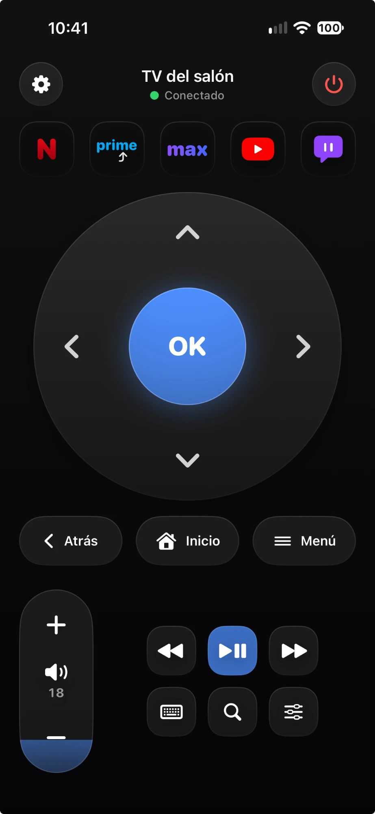
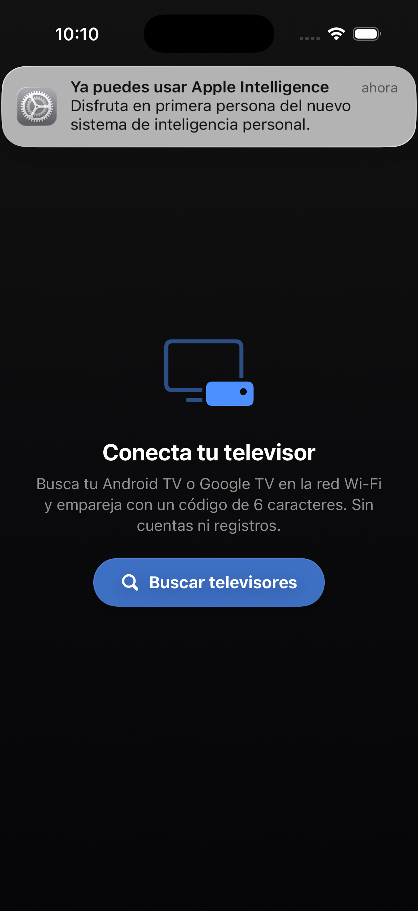

# Smart TV Remote

Mando a distancia para **Android TV / Google TV** desde el iPhone. App nativa en SwiftUI, sin dependencias
externas, que implementa desde cero el protocolo **Android TV Remote v2** (TLS con certificado de cliente + protobuf).


<p align="center">
  
  &nbsp;&nbsp;
  
</p>

## Características

- Cruceta, OK, atrás, inicio, volumen y silencio.
- Teclado para escribir en los campos de texto de la TV.
- Lanzador de aplicaciones (YouTube, Netflix, etc.) y acceso rápido a ajustes.
- Descubrimiento automático por Bonjour (`_androidtvremote2._tcp`) o alta manual por IP.
- Emparejamiento por código de 6 caracteres mostrado en la TV.
- Varias TVs guardadas y reconexión automática con backoff y watchdog.
- Encendido por Wake‑on‑LAN (experimental) y apagado con la tecla POWER.
- Certificado X.509 propio generado en el dispositivo y guardado en el Keychain, con anclaje del certificado de la TV.

## Requisitos

- iPhone con iOS 17 o superior y Xcode 15+.
- [XcodeGen](https://github.com/yonaskolb/XcodeGen) (opcional; el `.xcodeproj` ya está incluido).
- Una TV con Android TV / Google TV en la misma red local.

## Instalación

1. Clona el repositorio y, si modificas `project.yml`, regenera el proyecto:
   ```bash
   brew install xcodegen
   xcodegen generate
   ```
2. Abre `SmartTVRemote.xcodeproj` en Xcode. En **Signing & Capabilities** elige tu *Team*
   (vale un Apple ID gratuito) y, si hace falta, cambia el *Bundle Identifier*.
3. Conecta el iPhone, selecciónalo como destino y pulsa ▶. Si iOS lo pide, confía en tu perfil
   (Ajustes ▸ General ▸ VPN y gestión de dispositivos) y activa el Modo desarrollador.
4. Acepta el permiso **Red local**. Ve a Ajustes ▸ Buscar televisores ▸ toca tu TV ▸ escribe el código que aparece en la pantalla.

Compilar para el simulador desde la terminal:

```bash
xcodebuild -project SmartTVRemote.xcodeproj -scheme SmartTVRemote \
  -sdk iphonesimulator -destination 'generic/platform=iOS Simulator' \
  CODE_SIGNING_ALLOWED=NO build
```

## Arquitectura

MVVM con `async/await` y `Network.framework`. Código en `SmartTVRemote/Sources`:

| Módulo | Archivos |
|---|---|
| Interfaz | `Views/` (`RemoteView`, `DPadView`, `VolumeView`, `SettingsView`, `KeyboardInputView`, `PairingView`), `ViewModels/RemoteViewModel.swift` |
| Conexión | `Connection/TVConnectionManager.swift` (estados, reconexión, watchdog), `RemoteSession.swift`, `Networking/TLSChannel.swift` |
| Protocolo | `Protocol/` (codec protobuf propio, mensajes Polo y Remote v2, keycodes) |
| Descubrimiento | `Discovery/DeviceDiscovery.swift` (Bonjour, alta por IP, sondeo) |
| Emparejamiento y seguridad | `Pairing/PairingManager.swift`, `Security/` (X.509, DER, Keychain) |
| Persistencia | `Persistence/` (TVs y ajustes) |
| Apps y utilidades | `AppLauncher/`, `Utilities/` (Wake‑on‑LAN, feedback háptico) |

Permisos: solo `NSLocalNetworkUsageDescription` y `NSBonjourServices` (el `Info.plist` se genera desde `project.yml`).

## Estado de las pruebas

**Verificado**
- El proyecto compila (Xcode 26.1, SDK iOS 26.1) y la app arranca en el simulador.
- `Tools/SelfTest` (compilar con `swiftc` y ejecutar) comprueba la codificación protobuf, el parseo de volumen,
  los varint, que el certificado X.509 generado es válido según `openssl verify`, y que el hash SHA‑256 del
  emparejamiento coincide con una implementación independiente.
- El descubrimiento Bonjour detecta una TV real anunciando `_androidtvremote2._tcp`.

**Pendiente de probar con una TV real**
- Emparejamiento, handshake TLS, envío de teclas, volumen, teclado, apps y reconexión. Están implementados
  según el protocolo v2 conocido, pero aún no hay una prueba de extremo a extremo documentada.
  Si la pruebas con tu modelo de TV, abre un *issue* con el resultado.

**Limitaciones conocidas**
- El encendido depende de que la TV acepte conexión en reposo o de Wake‑on‑LAN (con la MAC introducida a mano; iOS puede exigir el entitlement multicast).
- El volumen solo se muestra si la TV lo informa; el protocolo no lista las apps instaladas.
- El teclado requiere un campo de texto enfocado en la TV; algunos fabricantes ignoran la tecla SETTINGS.
- Búsqueda por voz no implementada (la lupa abre la búsqueda de la TV).
- Los iconos de apps están dibujados en vectores, no son logotipos oficiales.

## Hoja de ruta

Panel táctil, voz, favoritos, widgets, Atajos y Apple Watch.

## Contribuir

Las *issues* y *pull requests* son bienvenidas, sobre todo informes de compatibilidad con distintos modelos de TV.

## Aviso legal

Proyecto independiente, sin relación con Google. «Android TV», «Google TV» y otras marcas citadas pertenecen a sus
respectivos propietarios. El protocolo se ha implementado a partir de documentación pública y ingeniería inversa de la comunicación entre dispositivos propios.

## Licencia

[MIT](LICENSE) © 2026 Ivan Sosa
